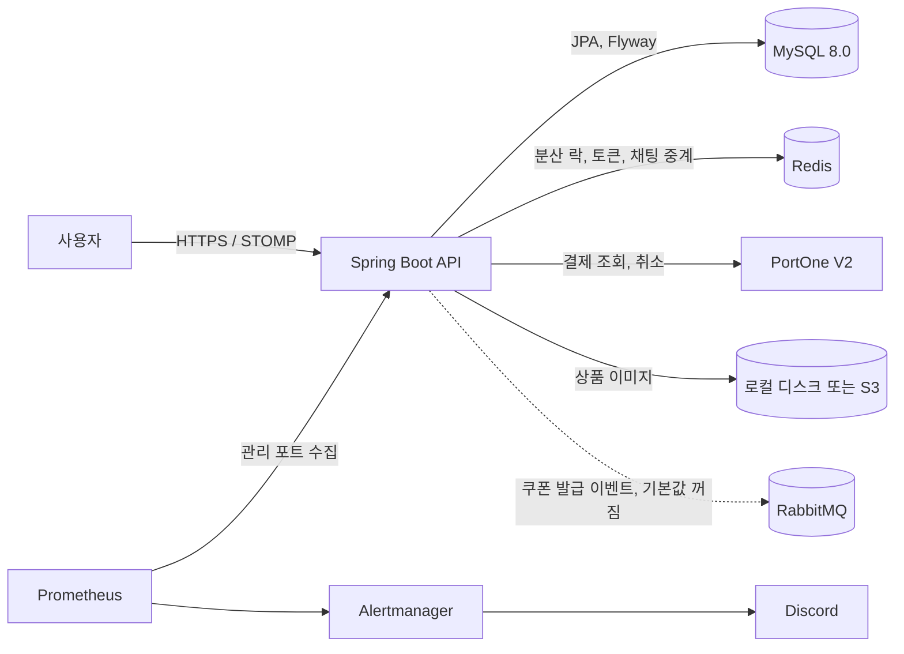
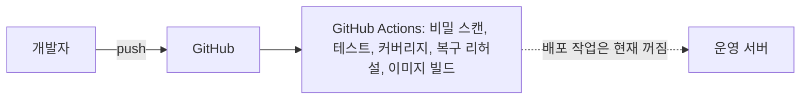
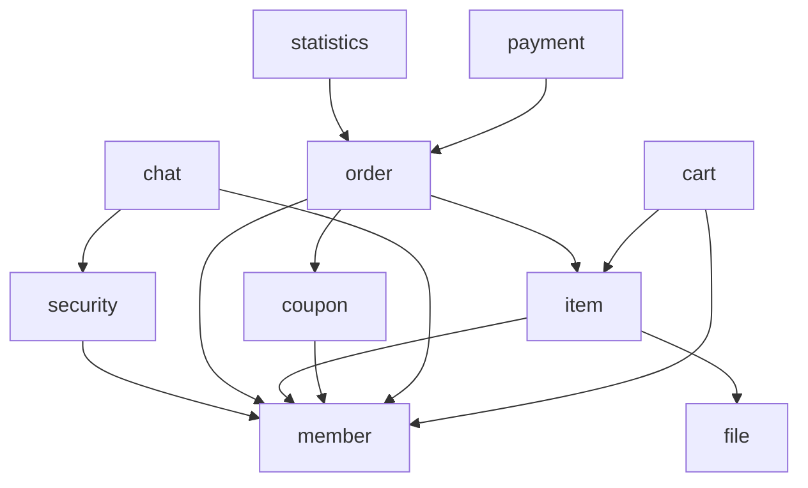

# 시스템 구성

코드, `compose.yml`, `package-info.java` 기준입니다. 운영 호스팅은 아직 정하지 않았습니다.

## 실행 구성

- **RabbitMQ:** `coupon.rabbit.enabled=true`일 때만 씁니다. `compose.yml`에는 없고 소비자도 없습니다. 이유는 [쿠폰 메시징 결정](coupon-messaging-decision.md)에 있습니다.
- **MySQL:** `compose.yml`의 `local-db` 프로필로 띄우거나 외부 DB를 씁니다.
- **모니터링:** `compose.yml`의 `monitoring` 프로필입니다.

## CI

## 모듈 의존성

`package-info.java`의 `allowedDependencies` 기준입니다. `global`은 대부분의 모듈이 쓰므로 생략했고, `file`은 다른 모듈에 의존하지 않습니다.

